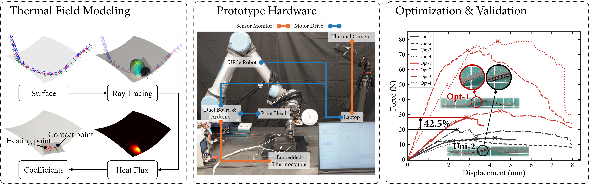

# Feedrate Optimization Based on Transient Thermal Modeling for IR-Assisted 3D Compaction Printing of Continuous Carbon Fiber-Reinforced Thermoplastics on Curved Surfaces

Python implementation of the transient thermal model and spatial feedrate
planner used in the study. 

## Abstract

Infrared-assisted 3D compaction printing of continuous carbon fiber-reinforced
thermoplastics on curved surfaces poses significant challenges for temperature
regulation, because the distributed and transient thermal footprint of the
infrared heat source interacts strongly with local surface geometry and
feedrate. This work achieves consistent temperature control at the contact
point through feedrate optimization enabled by a differentiable transient
thermal-field modeling framework formulated for curved surfaces. A
simulation-driven approach is used to identify path-dependent coefficient
functions in the thermal model, and an efficient backtracking algorithm is
developed to determine optimized printing feedrates. The proposed method is
validated through physical experiments on a robotic system equipped with
prototype desktop hardware.



## Run the examples

### Reconstruct a thermal field

```bash
python examples/reconstruct_thermal_field.py --case GeoC_p45 --segment 0
```

Choose any available case (`GeoA`, `GeoB`, `GeoC_p45`, `GeoC_0`, or `GeoC_m45`)
and segment index. Use `--time` to select a time within that segment, and
`--resolution` to change the grid dimensions. Larger grids take longer because
the model evaluates every grid point. To see all options, run:

```bash
python examples/reconstruct_thermal_field.py --help
```

### Run a VelPlanSpatial example

By default, this predicts temperature with a constant feedrate for the first
segment and prints the temperature and feedrate summaries:

```bash
python examples/velplan_spatial_example.py --case GeoC_p45 --segment 0
```

Add `--optimize` to run the sequential optimizer on that segment:

```bash
python examples/velplan_spatial_example.py --case GeoC_p45 --segment 0 --optimize
```

Use `--nodes` to change the number of path samples (12 by default). You can select the other cases and segments with
`--case` and `--segment`; list the options with:

```bash
python examples/velplan_spatial_example.py --help
```

## Cite us

If you use this code, please cite the associated [paper](https://doi.org/10.1016/j.compositesb.2026.114238). 

```bibtex
@article{Shi2026FeedrateOptimization,
  author  = {Shi, Zikang and Petty, Michael and Liu, Tao and Wang, Charlie C. L.},
  title   = {Feedrate Optimization Based on Transient Thermal Modeling for IR-Assisted 3D Compaction Printing of Continuous Carbon Fiber-Reinforced Thermoplastics on Curved Surfaces},
  journal = {Composites Part B: Engineering},
  year    = {2026},
  doi     = {10.1016/j.compositesb.2026.114238}
}
```
